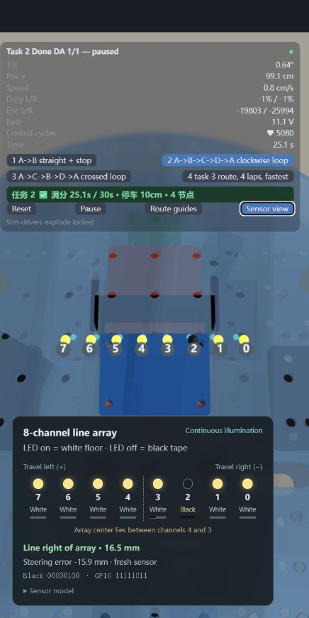

# mujoco-renode-twin

A digital twin of a two-wheel **balancing race car** (the 2024 H-sheet
smart-car exam): MuJoCo physics, the **real STM32F407 firmware** executed by
Renode, a host-compiled C fast path, and a three.js viewer — with build123d
CAD as the single geometry source behind all of it.



## What makes it interesting

- **Firmware-in-the-loop, for real.** The same ELF that flashes onto the
  board runs inside Renode behind the controller seam: sensors go in as raw
  I2C/GPIO/encoder traffic (a modeled MPU6050, quadrature edges on the
  encoder timers, PF0-7 line-bar pins), duty comes back decoded from
  TIM1+TB6612 registers — what the driver actually drove.
- **Three interchangeable controller slots, parity-gated.** Python stub ↔
  host-DLL C law (`hostc`) ↔ Renode ELF run the same missions; A/B gates
  pin duty series and closed-loop trajectories so the port is provably
  faithful (0‰ duty drift, <0.1°/1 mm trajectory deltas).
- **Ground-truth grading, not self-report.** The harness scores MuJoCo
  ground truth (beep placement at nodes, stop distance, time limit) while
  the controller only ever sees what the real sensors would show.
- **Record/replay that respects physics.** Every mission is recorded;
  the viewer can replay at ×N mid-run (catch-up over the recorded prefix,
  hands back to live at the frontier) or loop the finished run.
- **One geometry chain.** build123d parametric CAD → MJCF physics →
  exported glTF viewer model, all driven by the same dimension source
  (`src/cad_modeling/layout.py`).

## Architecture

Three layers, one direction of dependency:

| Layer | Package | Owns |
|---|---|---|
| vehicle + platform | `bot/` | MJCF physics, sensor/motor domains, LQR, the 200 Hz coupling loop, the controller seam, mailbox word packing, state frames, ws server, the shared Renode channel + peripheral bench |
| balance demo app | `twin/` | the balance demo riding the vehicle (TWN2 mailbox, twin firmware backend, UART session) |
| exam app | `race/` | the smart-car exam (track field, tasks, mission controller, RAC2 mailbox, race firmware backend, record/replay serve) |

`firmware/` mirrors the split: `core/balance.c` is the one control-law
source both firmware shells link; `twin/` and `race/` are the platform
shells; register drivers + Renode peripheral models live at the root.
`web/` is the shared three.js viewer. Each package's README carries its
own rules and evidence; `firmware/race_status.md` + `firmware/evidence/`
record the per-peripheral bring-up proof.

```
MuJoCo plant ─200 Hz─> sensors (raw domains) ─> mailbox words ─> controller slot
                                                                     ├─ Python stub
                                                                     ├─ hostc DLL (C law)
                                                                     └─ Renode ELF (real FW)
duty <─ zero-order hold ───────────────────────────────────────────────┘
state frames ─> BotServer (ws :8765/:8766) ─> three.js viewer (30 Hz, interpolated)
```

## Quickstart

Python ≥3.12 + [uv](https://docs.astral.sh/uv/); Node 18+ for the viewer;
`arm-none-eabi-gcc` and a [Renode](https://renode.io) portable install are
optional (firmware-in-the-loop path only).

```bash
uv sync                                   # python deps (mujoco, build123d, ...)
uv run python -m race --task 1            # host-C law, headless, graded
uv run python -m race --all               # all four exam tasks, verdict table
```

Generated headers must match the Python single sources (exit 1 if stale):

```bash
uv run python -m twin.fwconfig --check
uv run python -m race.fwconfig --check
```

The 3D viewer (dev services via `ops.py`, fixed ports):

```bash
uv run python ops.py start viewer race --task 1
# open http://localhost:5173/?ws=ws://127.0.0.1:8766
uv run python ops.py stop all
```

The firmware-in-the-loop path (build the ELFs, point at Renode):

```bash
bash firmware/twin/build.sh && bash firmware/race/build.sh
set RENODE_PORTABLE=C:\path\to\renode_portable     # your portable Renode root
uv run python -m race --task 2 --backend renode    # the real peripherals
```

## Tests

```bash
uv run python -m unittest tests.test_race tests.test_hostc_race tests.test_hostc_balance
uv run python -m pytest tests/test_twin.py tests/test_assembly.py -q
```

Renode-gated suites (`tests.test_firmware_*`, `tests.test_race_firmware`,
`tests.test_line_tracking`) skip without `RENODE_PORTABLE`; budget ~20 min
when they run — one at a time. CAD geometry gates skip without the vendor
models (see below).

## Third-party geometry

`assets/vendor/` (bought-part STEP models: JGB37-520 motor, GY-521,
TCRT5000, AMS1117) is **not redistributed** — fetch per
[assets/vendor/README.md](assets/vendor/README.md). The CAD assembles fine
without it: envelopes from the constants sheet are the default mode
(`collision`), vendor STEPs only enrich the `visual` export.

## License

MIT — see [LICENSE](LICENSE). The vendored third-party models (when
fetched) remain under their sources' terms.
